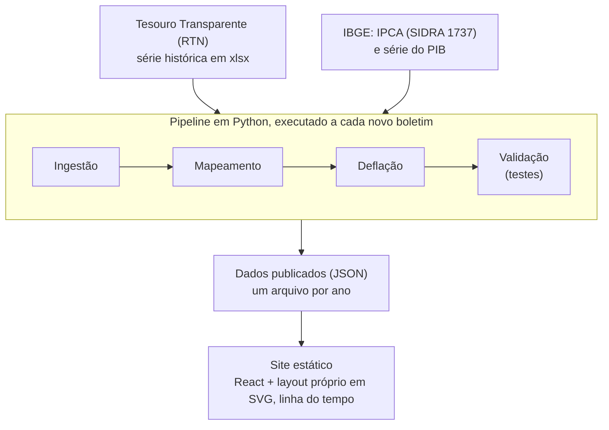

# Especificação do MVP: Sankey fiscal interativo do Governo Central

Posição de 21/10/2026. Este arquivo é a fonte de verdade para decisões de produto e de metodologia.
Quando uma decisão mudar, mude aqui no mesmo commit.

## Objetivo e escopo

O MVP é um Sankey interativo do Governo Central (Tesouro Nacional, Previdência Social e Banco Central), de 2015 a 2025,
com linha do tempo, dados oficiais do RTN e a metodologia visível em cada nó.

**Entra no MVP**

- Sankey receita total → repasses → receita líquida → despesa, no mesmo desenho do gráfico que motivou o projeto, mas com mapeamento próprio e documentado.
- Linha do tempo anual (2015–2025), com reprodução automática.
- Modos de leitura: R$ constantes de um mês-base, % da despesa total e % do PIB.
- Tooltip com valor, participação e a fonte da linha no RTN.
- Módulo separado de financiamento (juros e dívida), descrito mais abaixo.

**Fica fora do MVP**

- Estados, municípios e estatais. O RTN cobre só o Governo Central, e misturar o consolidado do Banco Central exigiria outra metodologia.
- Visão mensal e comparação entre dois períodos (fase posterior).
- Exportação em imagem ou vídeo.

**Posicionamento.** A ferramenta é independente: sem marca ou título que sugiram origem oficial (nada de "gov.br" no nome) e com a
frase "visualização independente, baseada em dados do Tesouro Nacional" visível na página.

## Metodologia

O Sankey fecha por construção em duas identidades, e todo valor é mostrado em R$ constantes de um mês-base (IPCA), nunca em nominal misturado entre anos.

$$RL = RT - T \qquad D = RL + F$$

RT = receita total; T = transferências por repartição de receita; RL = receita líquida; D = despesa total; F = déficit primário
(negativo em anos de superávit). Em 2025, em R$ correntes: RT 2.902,3 bi, T 569,7 bi, RL 2.332,6 bi, D 2.394,2 bi e F 61,7 bi.

**Qual resultado alimenta o desenho.** O RTN publica mais de um número para o mesmo ano. O MVP usa o resultado primário "acima da
linha" (R$ 61,7 bi em 2025), porque é o único que fecha com as linhas de receita e despesa do próprio boletim. A apresentação do
Tesouro traz também o resultado após deduções (R$ 13,0 bi, 0,10% do PIB), usado na verificação da meta fiscal; ele aparece no
tooltip, não no desenho.

**Deflação.** Cada fluxo mensal é corrigido pelo IPCA até o mês-base (padrão: dez/2025, como no gráfico original) e só depois
somado no ano. O RTN também calcula suas variações reais pelo IPCA, o que mantém a comparação com o boletim.

**Regime de registro.** O RTN registra receitas por caixa e despesas por pagamento efetivo. Pagamentos concentrados, como
precatórios e créditos extraordinários, deslocam um mês ou um ano inteiro, e o tooltip deve avisar isso.

**Modos de leitura**

- R$ constantes do mês-base.
- % da despesa total, para separar mudança de composição de aumento nominal.
- % do PIB, para comparar décadas. A fonte do PIB é o IBGE (ver decisões).

## Mapeamento RTN → nós do Sankey

Cada nó do gráfico original sai de linhas do RTN, e os seis nós de receita e os de despesa somam exatamente os totais do boletim.
O mapeamento executável está em `mapeamento.json`; os códigos abaixo são os da aba 1.2 da série histórica.

| Nó | Linhas do RTN | 2025, R$ bi correntes | Observação |
| --- | --- | --- | --- |
| Imposto de Renda | 1.1.03 | 867,3 | |
| Contribuição ao INSS | 1.3 Arrecadação líquida para o RGPS | 709,7 | |
| Cofins e PIS | 1.1.05 + 1.1.06 | 497,4 | |
| IOF, IPI e importação | 1.1.04 + 1.1.02 + 1.1.01 | 265,1 | |
| CSLL | 1.1.07 | 177,8 | |
| Royalties, dividendos e outras | 1.1.08 + 1.1.09 + 1.1.10 + 1.2 + 1.4 | 384,9 | Concessões, dividendos, exploração de recursos naturais, salário-educação e demais não administradas |
| **Receita total** | 1 | **2.902,3** | |
| Repasse a estados e municípios | 2 Transferências por repartição | 569,7 | FPM/FPE/IPI-EE respondem por 454,7 |
| **Receita líquida** | 3 | **2.332,6** | |
| Aposentadorias e pensões (INSS) | 4.1 Benefícios previdenciários | 1.026,9 | |
| Servidores ativos e inativos | 4.2 Pessoal e encargos | 402,6 | Inclui militares e precatórios de pessoal |
| Bolsa Família | 4.4.1.2 | 158,1 | |
| Saúde (obrigatória com controle de fluxo) | 4.4.1.3 | 170,5 | |
| Demais obrigatórias com controle de fluxo | 4.4.1.1 + 4.4.1.4 + 4.4.1.5 | 40,7 | Benefícios a servidores 21,3; educação 8,5; demais 10,9 |
| BPC (idosos e PcD) | 4.3.05 | 127,2 | |
| Fundeb, seguro-desemprego e outras obrigatórias | 4.3 menos 4.3.05 | 263,3 | Abono e seguro-desemprego 87,8; Fundeb 59,7; precatórios 42,8; subsídios 25,5; demais |
| Despesas discricionárias (custeio e investimentos) | 4.4.2 | 204,9 | |
| **Despesa total** | 4 | **2.394,2** | |
| Déficit primário | 5 | 61,7 | Fecha: 2.332,6 + 61,7 = 2.394,3 |

O original rotula "Bolsa Família, saúde e outros" (R$ 374 bi em preços de dez/2025). Isso é a rubrica oficial de obrigatórias com
controle de fluxo (linha 4.4.1). O projeto abre essa rubrica em Bolsa Família, Saúde e Demais já na versão 1.

Verificado contra o gráfico original: corrigindo cada linha por IPCA mês a mês para preços de dez/2025, os valores impressos saem
com diferença menor que R$ 1 bi.

## Casos de borda

O desenho do original só funciona em ano de déficit moderado; quatro situações da série 2015–2025 quebram o layout se não forem
tratadas antes da primeira versão.

- **Anos de superávit.** Com F negativo, o nó "Déficit primário" deixa de ser origem de fluxo e passa a ser destino (a receita
  líquida excede a despesa). Regra de layout: um único nó "Resultado primário" que fica do lado da entrada em déficit e do lado da
  saída em superávit, com o rótulo trocando entre "Déficit" e "Superávit". Em 2015–2025, 2022 é o único ano de superávit primário
  (R$ 54,1 bi); os demais anos fecharam em déficit.
- **Escala em 2020.** O déficit primário de 2020 foi de R$ 743,3 bi, cerca de 12 vezes o de 2025. Com escala compartilhada entre
  os anos, os fluxos de 2025 ficam finos perto do pico, o que é correto e deve ser explicado na tela. No modo % da despesa não há esse efeito.
- **Valores negativos.** Sankey não desenha fluxo negativo, e o RTN tem linhas que podem ficar negativas, como "Superávit dos
  Fundos" (−R$ 10,2 bi em 2025) e "Incentivos fiscais". Regra: agregar no nível do nó, de modo que todo fluxo desenhado seja não
  negativo; se um nó fechar negativo no ano, ele é netado com o nó irmão e o tooltip explica. Nos nós atuais nenhum fecha negativo
  em base anual; dois valores mensais são negativos (royalties/dividendos/outras em nov/2017 e Bolsa Família em jun/2020).
- **Mudanças de classificação.** Rubricas mudam de nome e de composição ao longo da série (por exemplo, "Bolsa Família e Auxílio
  Brasil"), e créditos extraordinários variam muito (R$ 25,7 bi em 2024, R$ 6,4 bi em 2025, por causa da calamidade no Rio Grande
  do Sul). Regra: em cada ano, a soma dos filhos deve fechar com o pai; linha nova que apareça no meio da série vai para "Demais"
  do mesmo pai, com nota de versão.

**Revisões.** O boletim traz a nota "dados sujeitos à alteração". O pipeline guarda a data de publicação de cada carga (a versão
dos dados) e a página mostra de qual boletim vêm os números.

## Arquitetura e pipeline

O MVP é um pipeline em Python que gera JSON estático e um site que só o lê, sem servidor nem banco de dados.

A validação é a única etapa que barra a publicação: se qualquer teste falhar, o JSON anterior continua no ar.

**Regras do frontend**

- Ordem dos nós fixa entre os anos, definida no mapeamento, para a animação mexer só na espessura e não reordenar nós.
- Escala compartilhada entre os anos no modo R$ constantes, para a espessura ser comparável; escala própria por ano nos modos percentuais.
- Layout próprio em SVG (função pura, sem d3-sankey), calculado uma vez e fixado, evitando que os nós "pulem" quando o ano muda.
- Tooltip com valor, participação, as linhas do RTN que formam o nó e o boletim de origem.
- O site vive em `castrillon.dev/sankey-fiscal`: caminhos de JSON e de arquivos devem funcionar a partir desse subcaminho.

## Validações automáticas

O pipeline roda a bateria de validação a cada carga e não publica nada se algum teste falhar: identidades contábeis (T1–T4),
mensal × anual (T5), deflação (T6), sinais (T7), regressão contra o gráfico original (T8), linhas e estrutura (T9–T12), PIB
do IBGE (T13), subcontas (T14, T15, T20, T21), notas (T16–T19, T22, T23) e as âncoras externas (A1–A4). A lista completa, com
o que cada teste verifica e os limites, está em `lista_testes` (`testes.py`); `python testes.py` imprime o resultado de cada um.

## Módulo de financiamento

O financiamento do governo vai num módulo próprio chamado "Necessidade de financiamento", e o nó do déficit primário no Sankey
principal deixa de se chamar "dívida nova".

| Governo Central, R$ bi correntes | 2024 | 2025 | Fonte |
| --- | --- | --- | --- |
| Primário acima da linha | −42,9 | −61,7 | RTN |
| Primário abaixo da linha | −45,4 | −58,7 | Banco Central; mesma série do RTN, linha 8 |
| Juros nominais | 855,2 | 891,9 | RTN, linha 9 (apurada pelo Banco Central) |
| Resultado nominal | −900,6 | −950,6 | RTN, linha 10 |

O dado fecha: −45,4 de primário mais −855,2 de juros dá −900,6 em 2024, e o mesmo vale para 2025 (−58,7 − 891,9 = −950,6).

**Regras do módulo**

- **Mesmo escopo do Sankey.** Usar os juros do Governo Central do RTN, não o consolidado do Banco Central, que inclui estados,
  municípios e estatais (R$ 1.007,6 bi de juros e R$ 1.062,6 bi de resultado nominal em 2025). Os dois conjuntos não se somam nem se comparam.
- **Reconciliação visível.** O resultado nominal do RTN parte do primário abaixo da linha, que difere do primário acima da linha
  usado no desenho (em 2025, R$ 58,7 bi contra R$ 61,7 bi, por diferença de metodologia entre Banco Central e Tesouro). O módulo
  mostra a ponte entre os dois, com ajustes metodológicos e discrepância estatística em linhas próprias, para que a soma feita pelo leitor feche.
- **Aviso sobre juros por competência.** Os juros do Banco Central são apropriados por competência e sofrem efeito de swap
  cambial: no consolidado, o ganho de R$ 105,9 bi com swaps em 2025 reduziu a conta, contra perda de R$ 115,9 bi em 2024.
  Comparações entre anos devem mostrar essa ressalva.
- **Rótulo no Sankey principal.** "Déficit primário (financiado com dívida)", com link para o módulo e a frase "não inclui juros"
  junto ao valor, e não só no rodapé.

## Roadmap e decisões

O MVP tem quatro fases em sequência, e nenhuma começa antes de a anterior cumprir seu critério de saída.

A fase 2 é a que reduz o risco: se 2025 não bater com o gráfico original dentro da tolerância, o mapeamento está errado e é melhor
descobrir isso antes de construir a linha do tempo. **Estado:** a fase 1 está concluída; a fase 2 está implementada em `web/`
(PR em rascunho, em revisão), com o critério de saída provado no Vitest: os 18 valores do gráfico original batem com o grafo de
2025 a até R$ 2 bi (maior diferença R$ 0,6 bi, no déficit). Detalhes em `docs/superpowers/specs/2026-10-21-fase-2-sankey-2025-design.md`.

**Decisões**

- **Onde vive a ferramenta.** Decidido: dentro do site pessoal, em castrillon.dev/sankey-fiscal. O site é publicado num projeto próprio na Vercel (configurado por `vercel.json` na raiz do repositório) e servido em castrillon.dev/sankey-fiscal pela reescrita da landing, que encaminha esse subcaminho ao domínio de produção do projeto. Os caminhos do JSON e dos arquivos do site precisam funcionar a partir desse subcaminho.
- **Nome do produto.** Decidido: `sankey-fiscal` (nome do repositório e da URL). Sem a marca gov.br e sem sugerir origem oficial.
- **Fonte e versão do PIB.** Decidido e carregado (fase 3a): IBGE, Contas Nacionais Trimestrais, SIDRA tabela 1846, PIB a preços de mercado, valores correntes (R$ 12,7 trilhões em 2025); o PIB do ano é a soma dos quatro trimestres. O CSV fica em `entrada/tabela1846.csv`, com a data do download em `entrada/LEIAME.md`, e o `indice.json` guarda o último trimestre do arquivo como versão da série (cada `AAAA.json` guarda o último trimestre somado no ano). O PIB implícito nas abas anuais do RTN continua como conferência (âncora A4). Teste de âncora: R$ 61,7 bi sobre o PIB do IBGE dá 0,48%, o valor do RTN.
- **Abrir "Bolsa Família, saúde e outros".** Confirmado: abrir em Bolsa Família, Saúde e Demais já na versão 1.
- **Escala em 2020.** Confirmado: escala compartilhada entre anos no modo R$ constantes, com aviso na tela.
- **Juros e resultado nominal do Governo Central.** Resolvido: os valores vêm da série histórica do RTN.
- **Painel e dica (fase 2).** Decidido: só clique, toque ou Enter abrem o painel de detalhes abaixo do desenho; o foco no nó
  (Tab) não abre o painel, e o hover de mouse mostra apenas uma dica curta (rótulo, valor, participação), sem mover o foco. No desktop o painel tem altura reservada; no desenho do celular, automática.
  O painel traz as linhas do RTN com código e nome oficial, com "menos" nas que subtraem.
- **Participação (fase 2).** Decidido: com a base escrita — "da receita total" no lado da receita (origens, receita total,
  receita líquida, repasse) e "da despesa total" no lado da despesa (inclusive o déficit).
- **Celular (fase 2).** Decidido: o mesmo Sankey, com rolagem horizontal em duas paradas (origens; destinos), alvos de toque de
  44 px e fonte mínima de 11 px. O desenho do desktop vale a partir de 1100 px de largura.
- **Temas (fase 2).** Decidido: claro e escuro por `prefers-color-scheme`, com paletas validadas para daltonismo; déficit com
  hachura nos dois temas e contorno claro no escuro.

## Fontes

- [Resultado do Tesouro Nacional, dezembro de 2025 (boletim)](https://cdn.tesouro.gov.br/sistemas-internos/apex/producao/sistemas/thot/arquivos/publicacoes/53718_1740106/boletim_dez25.pdf): receitas, despesas e resultado primário de 2025.
- [Apresentação do Tesouro, dezembro de 2025](https://static.poder360.com.br/2026/01/Tesouro-apresentacao-resultado-dez-25.pdf): resultado primário após deduções.
- [Banco Central, Nota para a Imprensa de 30/01/2026](https://www.bcb.gov.br/content/estatisticas/hist_estatisticasfiscais/202601_Texto_de_estatisticas_fiscais.pdf): primário do Governo Central em 2024 e 2025; juros e resultado nominal do consolidado.
- [Poder360, setor público consolidado em 2025](https://www.poder360.com.br/poder-economia/setor-publico-consolidado-tem-deficit-de-r-55-bilhoes-em-2025/): juros e resultado nominal do consolidado, efeito dos swaps.
- [Agência Brasil, contas públicas em 2025](https://agenciabrasil.ebc.com.br/economia/noticia/2026-01/contas-publicas-tem-deficit-de-r-55021-bilhoes-em-2025/): diferença de metodologia entre o primário do Banco Central e o do Tesouro.
- [IBGE, Contas Nacionais Trimestrais, 4º trimestre de 2025](https://agenciadenoticias.ibge.gov.br/agencia-noticias/45969-pib-cresce-2-3-em-2025.html): PIB de 2025 em valores correntes.
- [Agrolink, reprodução da Agência Brasil sobre 2022](https://www.agrolink.com.br/noticias/governo-central-registra-superavit-de-r--54-086-bi-em-2022_475769.html): superávit primário de R$ 54,086 bi.
- [Mais Retorno, Governo Central em 2021](https://maisretorno.com/portal/governo-central-tem-em-2021-deficit-de-r-35-bi-melhor-resultado-das-contas-desde-2014): déficit de R$ 743,255 bi em 2020.
- Tesouro Transparente, Resultado do Tesouro Nacional, séries históricas (arquivo de jul/2026, em `entrada/`).
- [IBGE SIDRA, tabela 1737](https://sidra.ibge.gov.br/tabela/1737): IPCA, número-índice (dez/1993 = 100).
- [IBGE SIDRA, tabela 1846](https://sidra.ibge.gov.br/tabela/1846): PIB a preços de mercado, valores correntes, trimestral (arquivo em `entrada/`).
